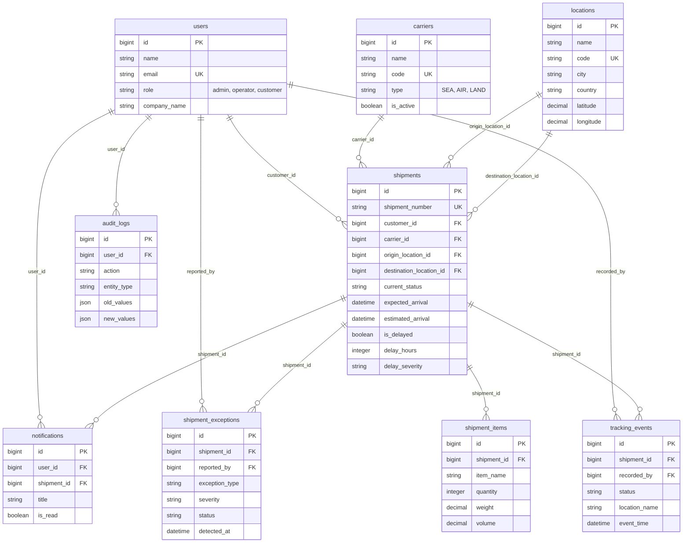

# CargoTrace — Global Maritime Shipment Visibility & Tracking Platform

[](https://laravel.com)
[](https://php.net)
[-10B981?style=for-the-badge&logo=githubactions&logoColor=white)](#automated-testing)
[](#postman-collection)
[](#project-overview--problem-statement)

CargoTrace is an enterprise-grade maritime logistics visibility and cargo tracking platform engineered for international freight forwarding. Focusing on the high-volume maritime trade corridor connecting **Southeast Asia to Europe**, CargoTrace replaces fragmented legacy tracking with deterministic delay analytics, finite state machine voyage transitions, incident exception handling (such as customs clearance holds), interactive geospatial mapping, and automated REST API capabilities.

---

## Table of Contents

1. [Project Overview & Problem Statement](#project-overview--problem-statement)
2. [Key Features & Business Rules](#key-features--business-rules)
3. [System Architecture & Database ERD](#system-architecture--database-erd)
4. [Tech Stack](#tech-stack)
5. [Local Installation & Setup Guide](#local-installation--setup-guide)
6. [Demo Accounts & Credentials](#demo-accounts--credentials)
7. [REST API Documentation & Postman Collection](#rest-api-documentation--postman-collection)
8. [Automated Testing](#automated-testing)
9. [Known Limitations & Future Work](#known-limitations--future-work)
10. [Third-Party Attribution & License](#third-party-attribution--license)

---

## Project Overview & Problem Statement

Global containerized supply chains face pervasive disruptions, documentation delays, and port congestions. Between Southeast Asia and European ports, consignments regularly transit high-risk choke points (Malacca Strait, Bab-el-Mandeb, Suez Canal, and North Sea gateways). Traditional tracking solutions suffer from subjective status guessing, unstandardized timestamps, and late discovery of customs holds.

### Core Domain Specifications:
- **Primary Operational Corridor**: Southeast Asia &rarr; Europe
  - *Origin Terminals*: Port of Tanjung Priok (`IDJKT`), Port of Singapore (`SGSIN`), Port of Tanjung Pelepas (`MYTPP`).
  - *Destination Terminals*: Port of Rotterdam (`NLRTM`), Port of Hamburg (`DEHAM`), Port of Antwerp-Bruges (`BEANR`).
- **Delay Tolerance Threshold**: **12 Hours** (`CARGOTRACE_DELAY_THRESHOLD=12`). Delays equal to or exceeding 12 hours trigger proactive operational alerts and severity classification.
- **Primary Operational KPI**: **On-Time Delivery Rate (%)** — evaluated strictly against contracted schedules versus calculated estimated arrivals.
- **Primary Operational Disruption Scenario**: `CUSTOMS_HOLD` (customs inspection, quarantine, EUR.1 certificate audits).

---

## Key Features & Business Rules

### 1. Role-Based Access Control (RBAC)
- **Administrator (`admin`)**: Master authority over carriers, port terminals, user accounts, system configuration, and immutable audit logs.
- **Logistics Operator (`operator`)**: Operational authority to create shipments, log chronological tracking milestones, recalibrate ETAs, and manage customs hold exceptions.
- **Shipper / Consignee (`customer`)**: Client portal access restricted strictly to their own consignments, active alert banners, and live map tracking.

### 2. Strict Finite State Machine (Status Lifecycle)
Voyage progress adheres strictly to the defined lifecycle sequence in `config('cargotrace.valid_statuses')`:
$$\text{CREATED} \longrightarrow \text{BOOKED} \longrightarrow \text{PICKED\_UP} \longrightarrow \text{IN\_TRANSIT} \longrightarrow \text{DELIVERED}$$
- Status transitions cannot skip steps or regress backwards.
- When `IN_TRANSIT`, intermediate waypoints can be recorded iteratively without advancing the state until arrival at the destination port (`DELIVERED`).
- `DELIVERED` is a terminal status; delivered consignments are locked from further editing.

### 3. Append-Only Historical Tracking Timeline
- Every tracking event captures location, status, UTC timestamp, reporter, and GPS coordinates.
- **Chronological Time Integrity**: Events must have an `event_time` greater than or equal to the previous milestone. Retroactive backdating is rejected with HTTP `422`.

### 4. Deterministic ETA & Delay Severity Rules
- Delay duration is calculated deterministically:
  $$\text{delay\_hours} = \text{estimated\_arrival} > \text{expected\_arrival} \; ? \; (\text{estimated\_arrival} - \text{expected\_arrival}) : 0$$
- If $\text{delay\_hours} \ge 12\text{h}$: marks `is_delayed = true` with severity classification:
  - **LOW**: $\le 6$ hours
  - **MEDIUM**: $> 6$ hours and $\le 24$ hours
  - **HIGH**: $> 24$ hours
- If the estimated arrival is restored on or ahead of schedule, `is_delayed` automatically resets to `false` and severity is cleared.

### 5. Operational Exception Management (`CUSTOMS_HOLD`)
- Operators report incidents (`CUSTOMS_HOLD`, `WEATHER_DELAY`, `PORT_CONGESTION`, `DAMAGED`, `MISROUTED`, `DOCUMENTATION_ISSUE`).
- Reporting an exception automatically injects an entry into the tracking timeline: `[EXCEPTION - {type}] {description}` and issues a high-priority notification to the customer.
- Lifecycle tracking: `OPEN` &rarr; `INVESTIGATING` &rarr; `RESOLVED` (capturing resolution timestamp).

### 6. Interactive Route Map (Leaflet.js + OpenStreetMap)
- Renders origin terminal (`DEP` - Emerald), chronological waypoint milestones (`NOW` - Ocean Blue with pulsing wave ring), and final discharge port (`ARR` - Rose).
- Renders maritime polyline with attribution to &copy; OpenStreetMap contributors.
- Auto-zooms using `map.fitBounds(polyline.getBounds())` for balanced screen framing.

### 7. External Logistics APIs (Resilient Integration)
- **Open-Meteo API**: Fetches real-time operational weather (temperature, wind velocity, WMO condition mapping) at the current GPS milestone with a 5-second timeout and graceful offline fallback.
- **OpenStreetMap Nominatim API**: Geocodes port and city queries (`GET /locations/geocode`) with "Auto-Fill Coordinates" inside the master data manager.

### 8. Analytics Dashboard & In-App Notifications
- Dual-mode dashboard:
  - *Admin/Operator Operations View*: 5 KPI cards (Total, In Transit, Delivered, Delayed, and Highlight Card for On-Time Delivery Rate), 2 Chart.js analytics graphs (Status Doughnut and Carrier Volume Bar Chart), and Priority Operational Action Items table.
  - *Customer Client Portal*: Quick summary cards, customs hold alert banner, and instant "Track on Map" buttons.
- Real-time notification center with unread bell badge on the navigation bar.
- Immutable System Audit Logs displaying actor user, action type, IP address, and before/after JSON diffs.

---

## System Architecture & Database ERD

CargoTrace follows a layered domain architecture separating presentation, authorization, business logic, and persistence. For full technical documentation, see [docs/ARCHITECTURE_AND_ERD.md](file:///c:/xampp/htdocs/CargoTrace_UAS_FINAL_Project/docs/ARCHITECTURE_AND_ERD.md).



---

## Tech Stack

| Component | Technology | Version | Purpose |
|---|---|---|---|
| **Framework** | Laravel | `^12.0` | Backend MVC architecture, routing, migrations, and ORM |
| **Language** | PHP | `^8.2` | Core backend runtime with strict typing |
| **Authentication** | Laravel Sanctum | `^4.0` | Session web authentication and REST API Bearer tokens |
| **Database** | MySQL / SQLite | `8.0+ / 3.x` | MySQL for application data; SQLite in-memory for testing |
| **Frontend Styling** | Tailwind CSS CDN | `^3.4` | Maritime Navy & Slate professional design system |
| **Interactive Maps** | Leaflet.js & OpenStreetMap | `1.9.4` | Interactive GIS route polyline and waypoint popups |
| **Data Visualization** | Chart.js | `^4.4` | Real-time operations doughnut and bar analytics |
| **Weather API** | Open-Meteo Forecast API | `v1` | Live waypoint weather intelligence (free academic use) |
| **Geocoding API** | OpenStreetMap Nominatim | `v1` | Reverse and forward port geocoding |
| **Testing** | PHPUnit | `^11.5` | Automated feature and unit testing suite |

---

## Local Installation & Setup Guide

Follow the steps below to run CargoTrace locally on your machine (e.g., using XAMPP or native PHP/MySQL):

### 1. Clone the Repository
```bash
git clone https://github.com/mera28/CargoTrace_UAS_FINAL_Project.git
cd CargoTrace_UAS_FINAL_Project
```

### 2. Install PHP Dependencies
```bash
composer install
```

### 3. Configure Environment Variables
Copy `.env.example` to `.env`:
```bash
copy .env.example .env
```
Ensure your database parameters in `.env` match your local MySQL configuration:
```ini
DB_CONNECTION=mysql
DB_HOST=127.0.0.1
DB_PORT=3306
DB_DATABASE=cargotrace
DB_USERNAME=root
DB_PASSWORD=

CARGOTRACE_DELAY_THRESHOLD=12
```

### 4. Create MySQL Database
Ensure MySQL service is running, then create the `cargotrace` database:
```sql
CREATE DATABASE IF NOT EXISTS cargotrace CHARACTER SET utf8mb4 COLLATE utf8mb4_unicode_ci;
```

### 5. Generate Application Key & Run Migrations with Seeders
```bash
php artisan key:generate
php artisan migrate:fresh --seed
```

### 6. Start the Local Development Server
```bash
php artisan serve
```
Open your browser and navigate to: **[http://127.0.0.1:8000](http://127.0.0.1:8000)**

---

## Demo Accounts & Credentials

The seeders pre-configure 4 accounts representing each business role. All demo accounts use the standard password: `password123`.

| Role | Name | Email Address | Password | Company / Access Scope |
|---|---|---|---|---|
| **Administrator** | Admin CargoTrace | `admin@cargotrace.test` | `password123` | CargoTrace HQ (Full System Authority) |
| **Logistics Operator** | Budi Santoso | `operator@cargotrace.test` | `password123` | CargoTrace Operations (Voyage & Risk Control) |
| **Customer (Shipper 1)** | Siti Rahma | `customer1@cargotrace.test` | `password123` | PT Nusantara Export (Client Consignment Portal) |
| **Customer (Shipper 2)** | Hendrik Van Der Berg | `customer2@cargotrace.test` | `password123` | EuroTrade Imports BV (Client Consignment Portal) |

---

## REST API Documentation & Postman Collection

CargoTrace provides a complete RESTful API authenticated via Laravel Sanctum Bearer tokens.

### Summary of Available API Endpoints:

| Method | Endpoint | Access Role | Description |
|---|---|---|---|
| `POST` | `/api/register` | Public | Register customer account & receive Bearer token |
| `POST` | `/api/login` | Public | Authenticate credentials & receive Bearer token |
| `POST` | `/api/logout` | Authenticated | Revoke active access token |
| `GET` | `/api/user` | Authenticated | Retrieve authenticated user profile |
| `GET` | `/api/shipments` | Authenticated | List shipments (scoped by customer ownership) |
| `POST` | `/api/shipments` | Admin, Operator | Create shipment with manifest items (HTTP 201) |
| `GET` | `/api/shipments/{id}` | Authenticated | Retrieve shipment details (403 for unauthorized customer) |
| `PUT` | `/api/shipments/{id}` | Admin, Operator | Update shipment parameters |
| `DELETE` | `/api/shipments/{id}` | Admin, Operator | Delete draft consignment |
| `GET` | `/api/shipments/{id}/tracking` | Authenticated | Retrieve tracking milestones timeline |
| `POST` | `/api/shipments/{id}/tracking` | Admin, Operator | Record milestone (strict FSM transition; 422 if invalid) |
| `GET` | `/api/shipments/{id}/exceptions` | Authenticated | Retrieve reported exceptions for shipment |
| `POST` | `/api/shipments/{id}/exceptions` | Admin, Operator | Report incident e.g. `CUSTOMS_HOLD` (HTTP 201) |
| `PATCH`| `/api/exceptions/{id}` | Admin, Operator | Update exception status (`OPEN`, `INVESTIGATING`, `RESOLVED`) |
| `GET` | `/api/carriers` | Authenticated | List all shipping carriers |
| `POST` | `/api/carriers` | Admin | Create shipping carrier (HTTP 201) |
| `GET` | `/api/locations` | Authenticated | List all port locations |
| `POST` | `/api/locations` | Admin | Create port location terminal (HTTP 201) |

### Postman Collection:
Import the ready-to-use Postman collection located at:
`docs/CargoTrace_API.postman_collection.json`
It includes predefined headers, dynamic collection variable `{{base_url}}`, automatic token extraction upon login, and valid sample payloads.

---

## Automated Testing

CargoTrace includes a comprehensive automated test suite powered by PHPUnit and Laravel `RefreshDatabase` executing against an isolated in-memory SQLite database.

To execute the entire test suite, run:
```bash
php artisan test
```

### Test Coverage Highlights (`tests/Feature/CargoTraceApiTest.php`):
- [x] **API Authentication**: Verifies successful login token issuance, rejection of invalid passwords (401), and unauthenticated endpoint denial (401).
- [x] **Customer Authorization Scoping**: Confirms customer only sees their own consignments on `GET /api/shipments` and receives `403 Forbidden` when attempting to inspect another customer's consignment.
- [x] **Role Action Authorization**: Confirms customers receive `403 Forbidden` when attempting administrative/operator write actions (`POST /api/shipments`, `POST /api/shipments/{id}/tracking`).
- [x] **Shipment Creation**: Validates operator creating shipments with line items and automatic initial milestone registration (HTTP 201).
- [x] **Invalid Status Transition**: Validates strict Finite State Machine rejecting illegal jumps (e.g. `CREATED` &rarr; `DELIVERED`) with HTTP 422.
- [x] **Deterministic ETA & Delay Rules**: Verifies `EtaService` calculates delay variance accurately against threshold 12h, classifying severity accurately (`MEDIUM` for 18h, `HIGH` for 30h, and on-time for 5h).
- [x] **Master Data Controls & Exception Lifecycle**: Verifies carrier creation by admin and incident resolution workflow.

---

## Known Limitations & Future Work

1. **Carrier EDI/API Webhooks**: Currently, tracking events and ETA updates are recorded via operators and REST API endpoints. Future iterations will support direct Electronic Data Interchange (EDI 214/315) and carrier webhooks (e.g., Maersk API, Ocean Insights).
2. **Real-time IoT Telematics**: Container temperature, humidity, and real-time satellite transponder feeds can be integrated via MQTT broker adapters.
3. **External Communication Channels**: Notifications are currently delivered in-app. Integration with Twilio (WhatsApp/SMS) and SendGrid (Email dispatch) is planned for critical delay escalation.

---

## Third-Party Attribution & License

- **[Laravel Framework](https://laravel.com)** — Open-source web framework by Taylor Otwell and contributors under the MIT License.
- **[Laravel Sanctum](https://laravel.com/docs/sanctum)** — API token authentication system under the MIT License.
- **[Tailwind CSS](https://tailwindcss.com)** — Utility-first CSS framework by Tailwind Labs under the MIT License.
- **[Leaflet.js](https://leafletjs.com)** — Open-source JavaScript library for interactive maps by Vladimir Agafonkin under the 2-Clause BSD License.
- **[OpenStreetMap](https://www.openstreetmap.org/copyright)** — Map data &copy; OpenStreetMap contributors under the Open Database License (ODbL).
- **[Chart.js](https://www.chartjs.org)** — Open-source JavaScript charting library under the MIT License.
- **[Open-Meteo API](https://open-meteo.com)** — Free weather API for open-source and academic use under Attribution 4.0 International (CC BY 4.0).

---

*CargoTrace is developed as a Final Project (UAS) for Web-Based Application Engineering.*
