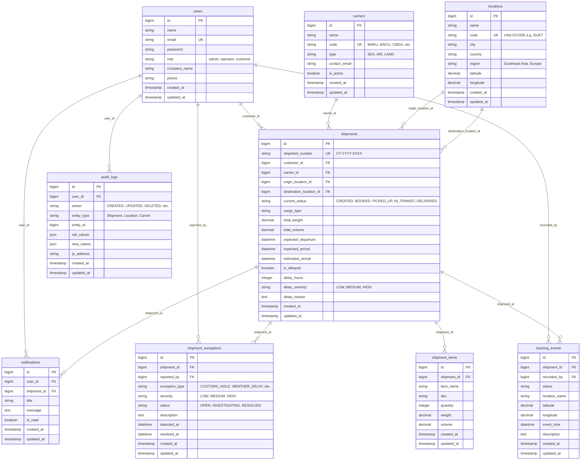

# CargoTrace Architecture & Database Entity Relationship Diagram (ERD)

This document provides a comprehensive technical reference for the software architecture, layered separation of concerns, and relational database schema powering the **CargoTrace** maritime intelligence and shipment tracking platform.

---

## 1. Layered System Architecture

CargoTrace adheres to a clean, decoupled **Layered Architecture Pattern** that enforces single responsibility, testability, and operational stability:

```
[ Client Layer (Browser / REST API Consumers / Postman) ]
                           │
                           ▼
[ Routing Layer (routes/web.php & routes/api.php) ]
                           │
                           ▼
[ Middleware Layer (Authenticate, RoleMiddleware, Sanctum, Throttle) ]
                           │
                           ▼
[ Controllers (Http/Controllers & Http/Controllers/Api) ]
                           │
                           ▼
[ Service Layer (Domain Business Rules & Integrations) ]
  ├── ShipmentService (Transaction management & manifest aggregation)
  ├── TrackingService (Finite State Machine & chronological integrity)
  ├── EtaService (Deterministic delay variance & severity evaluation)
  ├── ExceptionService (Incident lifecycle & tracking event injection)
  ├── ExternalLogisticsService (Open-Meteo Weather & Nominatim Geocoding)
  └── AuditLogService (Append-only governance trail)
                           │
                           ▼
[ Eloquent Models & Data Access Layer (App/Models) ]
                           │
            ┌──────────────┴──────────────┐
            ▼                             ▼
[ Relational Database (MySQL) ]   [ External REST APIs ]
                                    ├── Open-Meteo Forecast
                                    └── OpenStreetMap Nominatim
```

### Architectural Breakdown:

1. **Routing & Gateway Layer (`routes/web.php`, `routes/api.php`)**:
   - Manages web session endpoints and stateless `/api/*` routes.
   - Rejects unauthenticated traffic and enforces strict HTTP method routing.

2. **Middleware & Security Guard Layer (`app/Http/Middleware/`)**:
   - `RoleMiddleware`: Enforces server-side Role-Based Access Control (`role:admin,operator`, `role:admin`). Rejects unauthorized actors with HTTP `403 Forbidden`.
   - `auth:sanctum`: Validates Bearer token headers for REST API requests.
   - Global JSON error handler in `bootstrap/app.php`: Intercepts exceptions on API routes and formats them into consistent JSON envelopes (`401`, `403`, `404`, `422`, `500`) without exposing internal stack traces.

3. **Controller Presentation Layer (`app/Http/Controllers/`)**:
   - Thin controllers responsible only for HTTP request validation, invoking appropriate Service Layer methods, and returning Blade views or JSON responses.
   - Web controllers: `AuthController`, `DashboardController`, `ShipmentController`, `CarrierController`, `LocationController`, `ShipmentExceptionController`, `TrackingEventController`, `NotificationController`, `AuditLogController`.
   - API controllers: `AuthApiController`, `ShipmentApiController`, `ResourceApiController`.

4. **Service Layer (`app/Services/`)**:
   - Encapsulates all domain business logic away from controllers:
     - **`ShipmentService`**: Atomically creates shipments using `DB::transaction`, generates standardized sequential identifiers (`CT-YYYY-XXXX`), and handles role-scoped filtering.
     - **`TrackingService`**: Enforces the Finite State Machine (FSM) sequence (`CREATED` &rarr; `BOOKED` &rarr; `PICKED_UP` &rarr; `IN_TRANSIT` &rarr; `DELIVERED`) and ensures chronological time order (`event_time >= previous milestone`).
     - **`EtaService`**: Calculates delay variance against contracted `expected_arrival`. When `delay_hours >= 12`, marks `is_delayed = true` and assigns severity rating (`LOW` $\le 6$h, `MEDIUM` $> 6$h & $\le 24$h, `HIGH` $> 24$h).
     - **`ExceptionService`**: Handles operational incidents (focus: `CUSTOMS_HOLD`), injects milestone entries into the tracking timeline, and updates incident statuses (`OPEN` &rarr; `INVESTIGATING` &rarr; `RESOLVED`).
     - **`ExternalLogisticsService`**: Integrates with Open-Meteo API for real-time waypoint weather and OpenStreetMap Nominatim for port geocoding, wrapped in resilient try-catch blocks with 5-second timeouts.
     - **`AuditLogService`**: Centralized helper storing actor ID, action, model class, model ID, before/after diffs, and client IP address.

5. **Model Layer (`app/Models/`)**:
   - Eloquent models configured with mass-assignment `$fillable` protection, explicit relationship declarations, and type `$casts`.

---

## 2. Entity Relationship Diagram (ERD)

The diagram below illustrates all 9 database tables, their primary/foreign key attributes, and relationship cardinalities using Mermaid syntax:



---

## 3. Database Data Dictionary

| # | Table Name | Primary Function | Key Foreign Keys | Design Decision & Integrity Rules |
|---|---|---|---|---|
| 1 | `users` | Platform authentication and multi-role identity management | None | Contains `role` column (`admin`, `operator`, `customer`) used by middleware for authorization. Supports Sanctum personal access tokens. |
| 2 | `carriers` | Master directory of contracted shipping and freight lines | None | Unique UN-compliant carrier code (`code`). `is_active` flag prevents scheduling bookings on decommissioned lines. Soft delete protected by relational checks. |
| 3 | `locations` | Geographic directory of seaports, air terminals, and transit hubs | None | UN/LOCODE standard unique code. Precise `decimal(10, 7)` latitude and longitude used by Leaflet.js interactive maps and Open-Meteo weather lookups. |
| 4 | `shipments` | Core aggregate entity tracking cargo consignment voyages | `customer_id`, `carrier_id`, `origin_location_id`, `destination_location_id` | Stores contracted baseline schedule vs dynamic ETA calculations. Contains deterministic flags `is_delayed` and `delay_severity` based on 12-hour corridor threshold. |
| 5 | `shipment_items` | Itemized cargo manifest contents and volumetric properties | `shipment_id` (`cascadeOnDelete`) | Supports composite shipments with individual weights and cubic volume (CBM). Cascade deletion ensures items are purged if draft shipment is removed. |
| 6 | `tracking_events` | Immutable, append-only chronological voyage event timeline | `shipment_id` (`cascadeOnDelete`), `recorded_by` (`nullOnDelete`) | Strictly validates state transitions and ascending chronological timestamps. Every recorded event captures GPS coordinates for route polyline mapping. |
| 7 | `shipment_exceptions` | Risk incidents, port congestions, and customs clearance holds | `shipment_id` (`cascadeOnDelete`), `reported_by` (`nullOnDelete`) | Tracks operational lifecycle (`OPEN` &rarr; `INVESTIGATING` &rarr; `RESOLVED`). Focus scenario `CUSTOMS_HOLD` automatically logs an event in `tracking_events`. |
| 8 | `notifications` | In-app notification center for shippers and operations staff | `user_id` (`cascadeOnDelete`), `shipment_id` (`nullOnDelete`) | Delivers proactive alerts on delays and customs clearance holds. Features `is_read` flag displayed on top-bar notification bell badge. |
| 9 | `audit_logs` | Append-only security and governance audit trail | `user_id` (`nullOnDelete`) | Captures actor user ID, action (`CREATED`, `UPDATED`, `DELETED`, `ETA_UPDATED`), target model, before/after JSON diffs, and client IP address. Immutable. |

---

## 4. API & Integration Reference

- **Postman Collection**: Refer to [`docs/CargoTrace_API.postman_collection.json`](file:///c:/xampp/htdocs/CargoTrace_UAS_FINAL_Project/docs/CargoTrace_API.postman_collection.json) for ready-to-import endpoint definitions and sample payloads.
- **Automated Feature Tests**: 100% of API endpoints, authorization guards, and business logic are covered in [`tests/Feature/CargoTraceApiTest.php`](file:///c:/xampp/htdocs/CargoTrace_UAS_FINAL_Project/tests/Feature/CargoTraceApiTest.php).
